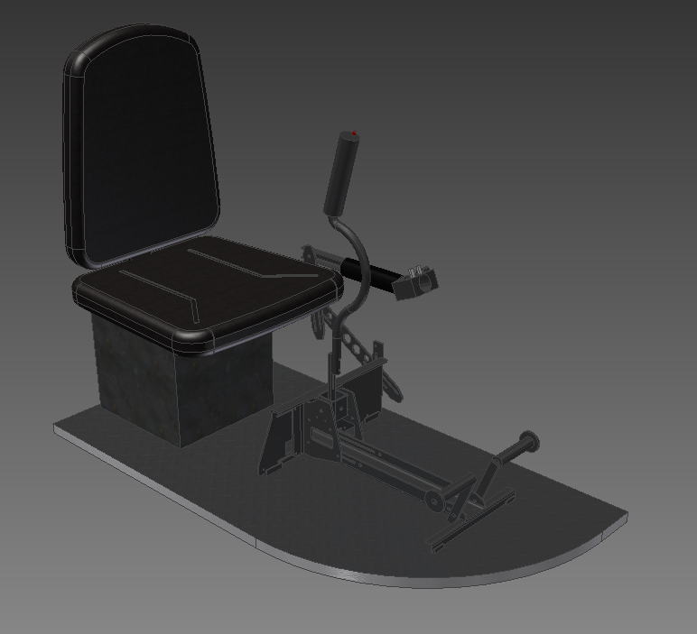
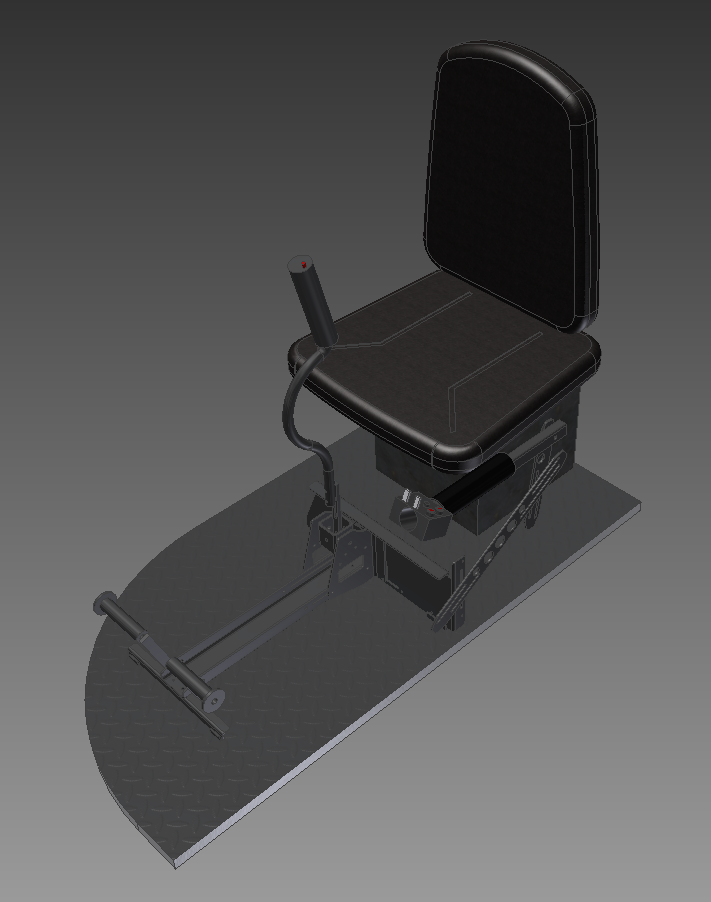
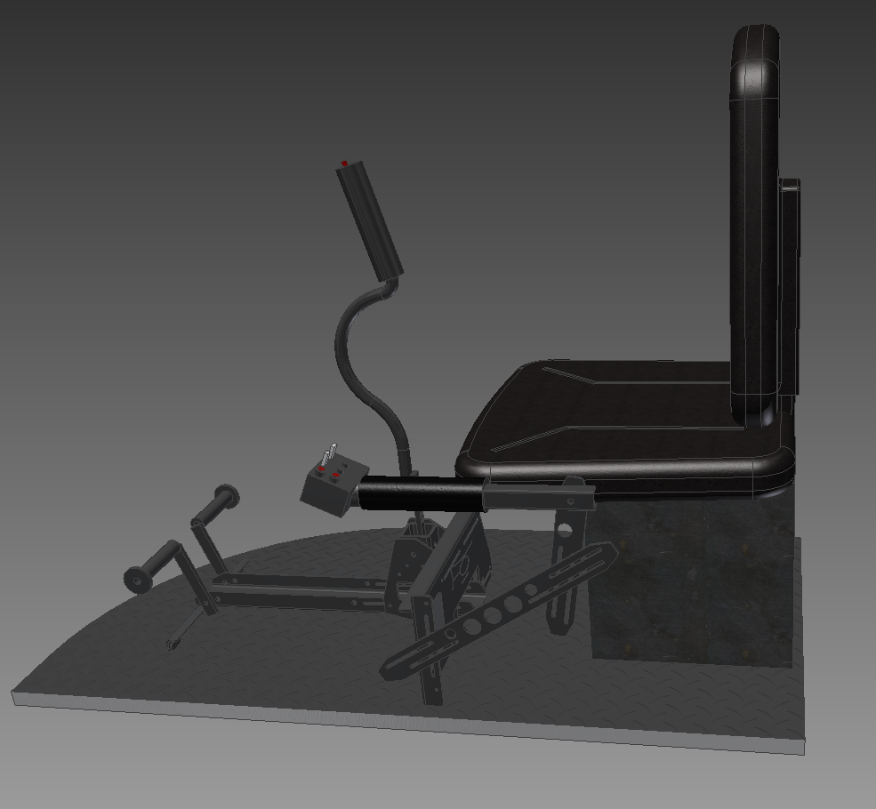
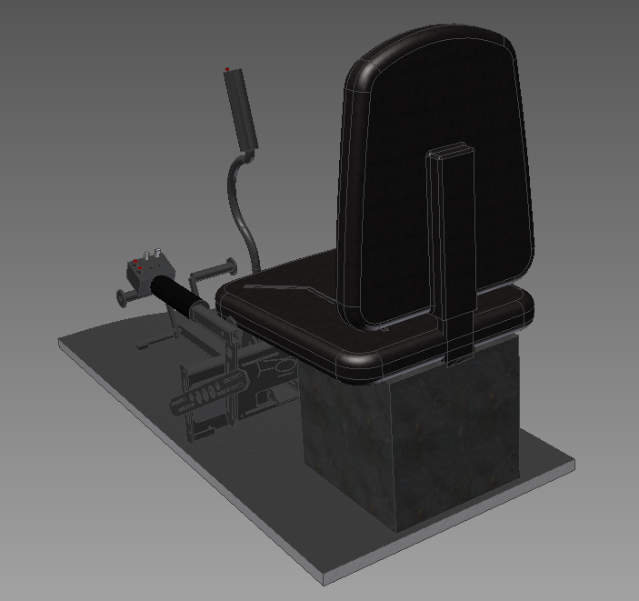
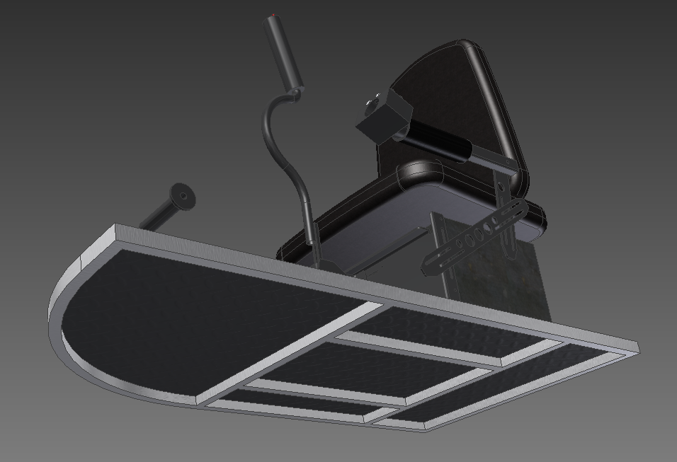
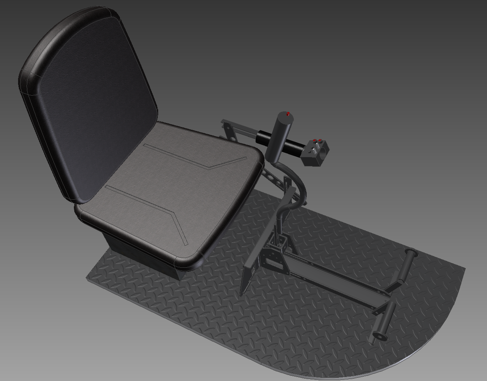

# Helicopter-PC-trainer
Designed in Autodesk Inventor, this project allows you to build your own helicopter controller for a flight simulator. Mechanical parts are mostly done, it remains to add bearings and electrical sensors according to your preference.
Collective and cyclic are generic, either design something more detailed, or use any other project with buttons, throttle, etc.

